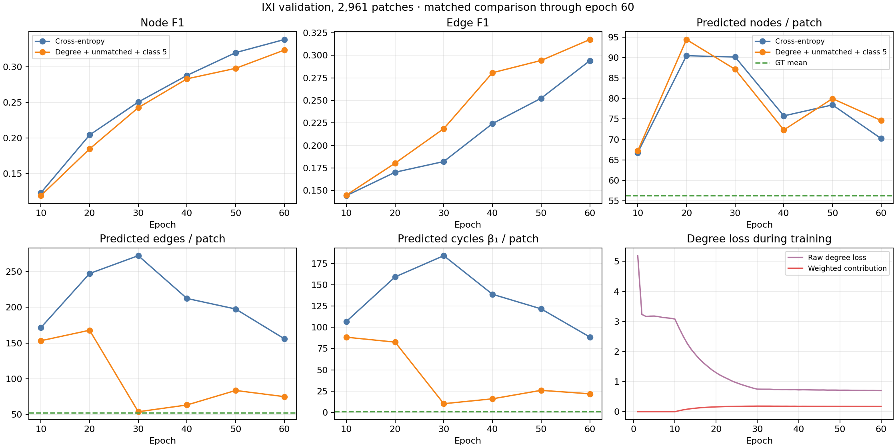

# IXI degree-consistency training experiment

The [300-epoch configuration](../../../../configs/finetune_ixi_vessels_q256_degree_consistency_300ep.yaml)
starts from the same IXI-only 8,000-patch split, seed, model, and 256 queries as
the earlier node-type cross-entropy baseline. It adds three changes:

1. A differentiable degree loss sums the edge probability of every sampled
   matched-node pair at each endpoint and compares that expected degree with
   the ground-truth patch degree using Smooth L1 loss. When the 9,999-pair cap
   samples negatives, their contributions are scaled by the inverse sampling
   fraction. Its weight ramps to 0.25 after a 10-epoch warmup.
2. Up to 32 unmatched queries predicted as objects enter a capped pool of 256
   hard negative edge pairs per patch, with a weight ramping to 0.25. The
   9,999 matched-pair limit remains unchanged.
3. The object/no-object classification loss weight rises from 4 to 5. This
   increases the whole classification objective; it does not specifically
   increase the background class weight, so reduced false-positive nodes is a
   hypothesis to check rather than a guaranteed effect.

The degree loss reuses matched-pair relation logits before class-ratio
upsampling, avoiding an extra relation-head pass. Training writes individual
loss terms to `training-losses.jsonl` and runtime to `performance.jsonl` in the
run directory.

The 2-epoch real-IXI smoke job **465089** completed successfully (64 train, 32
validation patches; 55 seconds total; 3.6 GiB peak GPU allocation). Focused
regression tests passed (38 tests, including degree-loss gradients and unmatched
negatives). Full job **465195** is running on 2 H100s with a 15-hour `t3`
limit. Dependent job **471400** will evaluate its validation-selected checkpoint
on all 2,384 held-out IXI test patches with both plain and fixed 0.5-degree
decoding; it will also save four sample images for each setting.



At epoch 60, the new run predicted 75 edges and 22 cycles per validation
patch, versus 156 edges and 89 cycles for the baseline at the same epoch.
Ground truth averages 52 edges and 0.83 cycles. Edge F1 was 0.317 versus
0.294, while edge mAP was 0.026 versus 0.041. Node F1 was 0.324 versus
0.339, and predicted nodes were 75 versus 70 (ground truth: 56). The larger
classification weight has not reduced node overprediction by this point. The
lower edge mAP and Branch F1 need attention as training continues; these
early curves do not establish the final ranking.

Refresh the figure as training progresses:

```bash
python docs/research/evidence/degree_consistency/plot_progress.py \
  --runs-root /lustre/fsn1/projects/rech/vnc/upz25mj/experiments/gnbm
```

Training output:
`/lustre/fsn1/projects/rech/vnc/upz25mj/experiments/gnbm/ixi_q256_degree_consistency_300ep_20261001/`
