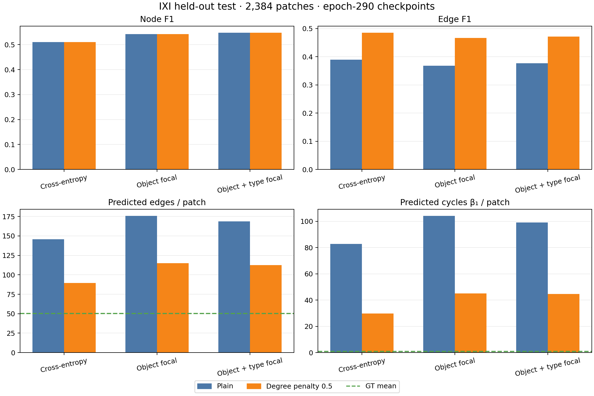

# IXI focal-loss ablation: held-out test results

Three models used the same IXI-only training split (8,000 patches), seed 364505,
256 object queries, 300 epochs from random initialization, and the same
2,384-patch held-out IXI test split. Every checkpoint was selected at epoch 290
by validation Branch F1. "Object focal" changes the object/no-object loss to
softmax focal loss (gamma 2). "Object + type focal" also changes the four-class
node-type loss to focal loss (gamma 2). Edge classification stays cross-entropy.
The degree penalty 0.5 was fixed from the earlier decoder comparison; it changes
only inference, not model weights.



| Model | Decoder | Node F1 | Node mAP | Edge F1 | Edge mAP | Branch F1 | Pred. edges / patch | Pred. cycles / patch |
|---|---|---:|---:|---:|---:|---:|---:|---:|
| Cross-entropy | Plain | 0.5103 | 0.0984 | **0.3894** | 0.1011 | 0.00887 | **145.87** | **82.82** |
| Object focal | Plain | 0.5417 | 0.1355 | 0.3679 | 0.1128 | 0.01103 | 175.65 | 104.05 |
| Object + type focal | Plain | **0.5474** | **0.1360** | 0.3771 | **0.1152** | **0.01124** | 168.61 | 99.12 |
| Cross-entropy | Degree 0.5 | 0.5103 | 0.0984 | **0.4847** | 0.0937 | 0.01008 | **89.60** | **29.70** |
| Object focal | Degree 0.5 | 0.5417 | 0.1355 | 0.4663 | 0.1079 | **0.01283** | 114.93 | 45.15 |
| Object + type focal | Degree 0.5 | **0.5474** | **0.1360** | 0.4716 | **0.1103** | 0.01262 | 112.50 | 44.73 |

Ground truth averages 54.35 nodes, 50.39 edges, and 0.77 cycles per patch.
The focal models improve node F1 and node mAP. Focal loss on node types adds a
small further gain over object focal alone. Both focal models predict more edges
and cycles than the cross-entropy model. The degree penalty reduces these errors
substantially for every model, but none approaches the ground-truth cycle count.
At penalty 0.5, cross-entropy has the highest edge F1 and lowest edge-count
error; the object + type focal model has the highest edge mAP and node F1.
Branch F1 remains around 0.01 in every setting, so these changes do not resolve
physical branch matching.

The full exact-value table is [metrics.csv](metrics.csv). Raw summaries,
per-patch metrics, predictions, and evaluation metadata are in each run's
`evaluation/test_best_branch_f1/` and
`evaluation/test_degree_penalty/penalty_0.5/` directories under
`/lustre/fsn1/projects/rech/vnc/upz25mj/experiments/gnbm/`. The four new
evaluation jobs were 463439, 463440, 464139, and 464140; each completed with
exit code 0. Regenerate the plot and CSV with:

```bash
python docs/research/evidence/focal_ixi_300ep/plot_comparison.py \
  --runs-root /lustre/fsn1/projects/rech/vnc/upz25mj/experiments/gnbm
```

These held-out test results are exploratory evidence for model selection. A
final paper estimate should use an untouched holdout after the loss and decoder
choices are frozen.
